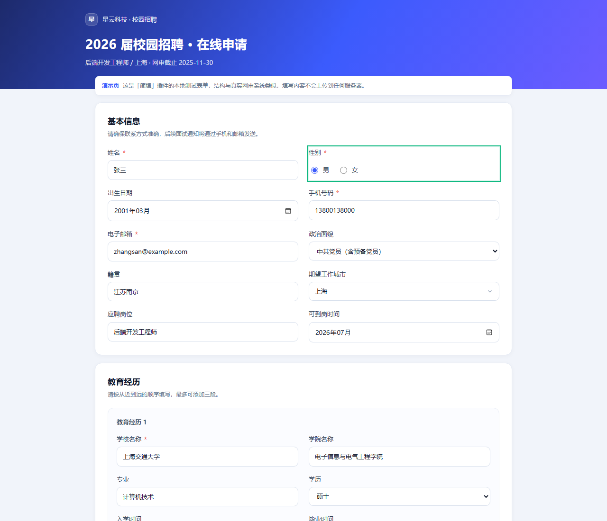
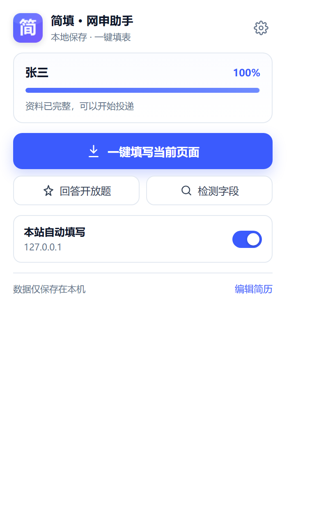
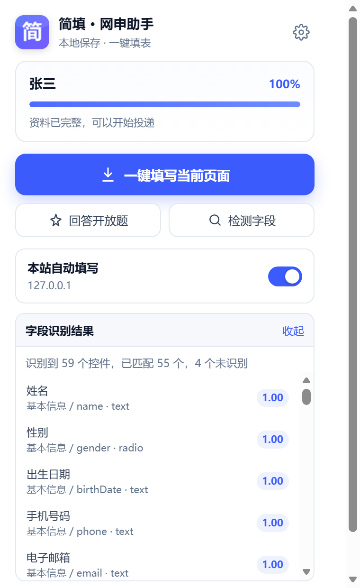
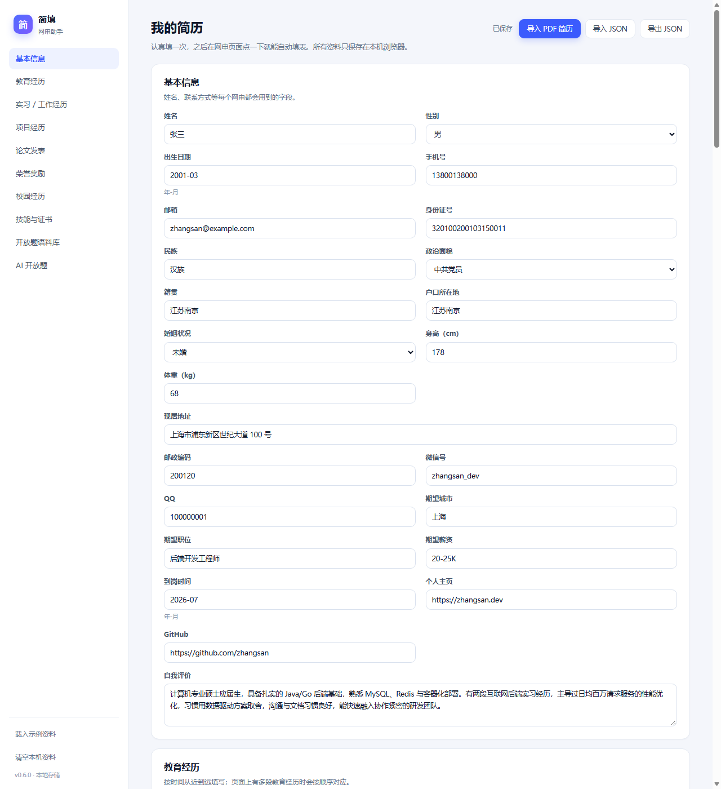
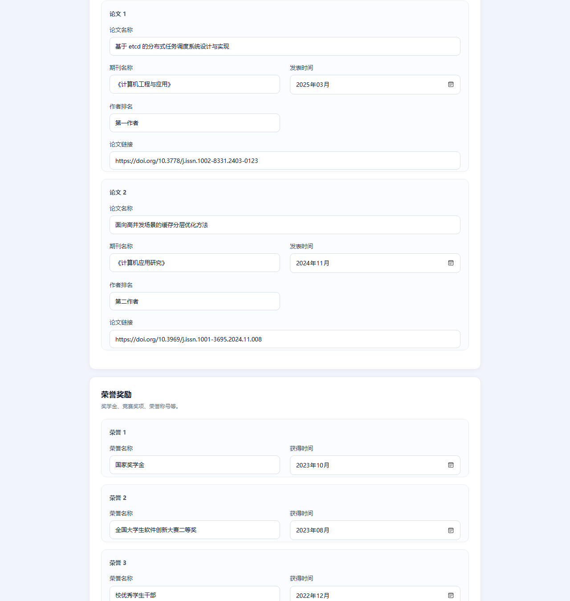
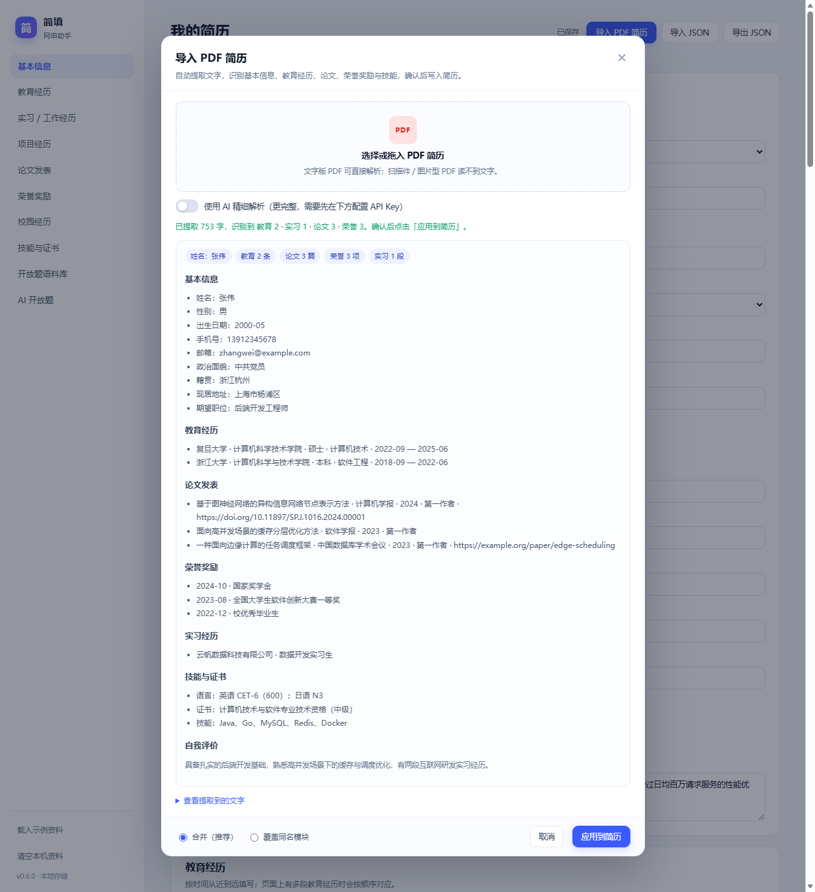
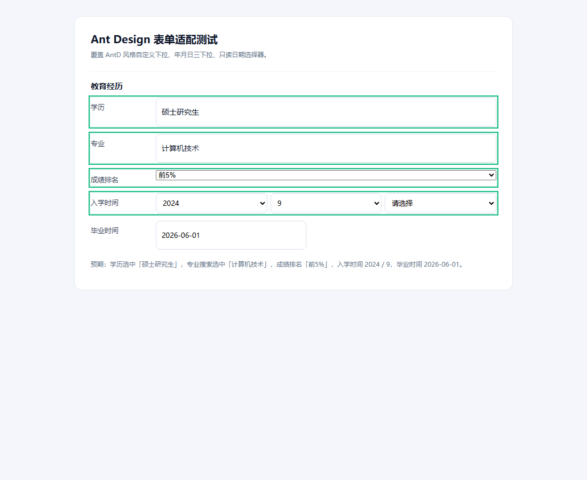
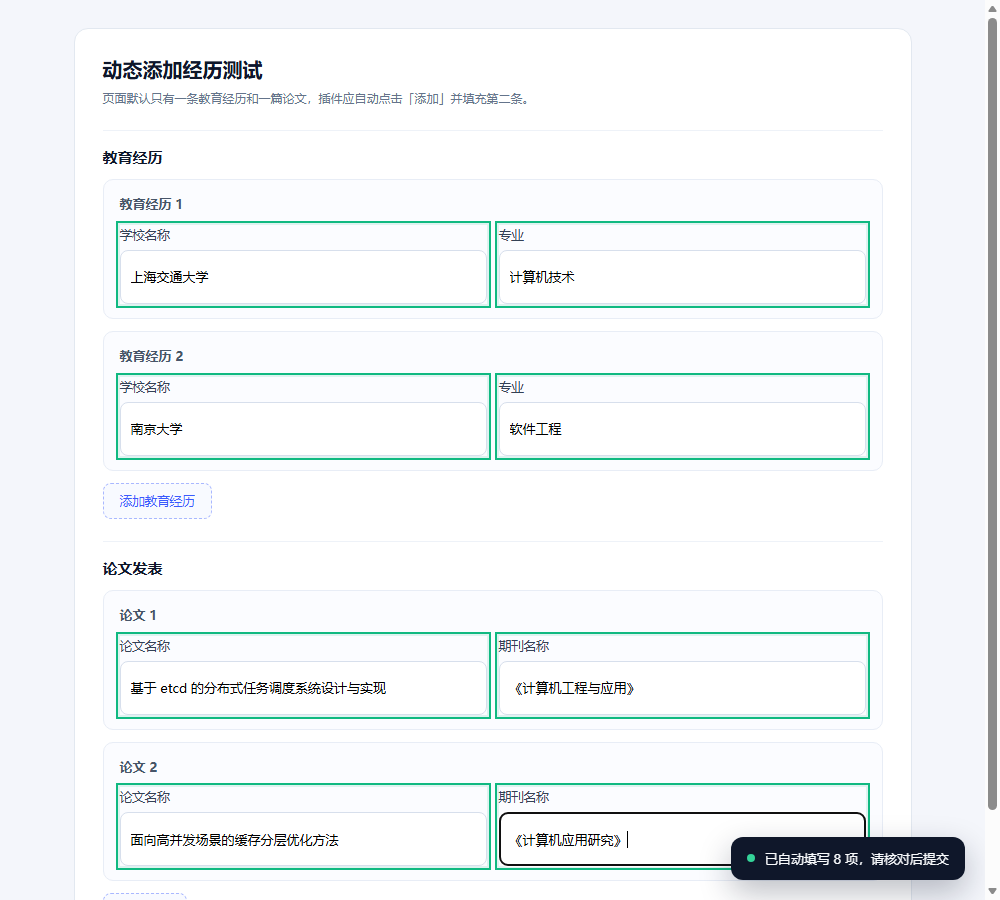

# 简填 · 网申助手

一份简历，一键填完网申。

一个**本地优先**的 Chrome / Edge 扩展：把校招、秋招网申里反复填的个人信息、教育经历、实习经历、项目经历、论文发表、荣誉奖励、技能证书自动填好；支持导入 PDF 简历解析填充；开放题可以先用本地语料库，再可选地交给自己的 AI 接口。

> 产品形态参考了 [CvMax 网申助手](https://cvmax.cn/index) 这类「网申自动填表」工具，但代码、图标、文案均为独立实现，没有抓取其页面或逆向其代码。本项目更适合作为自己维护、按需改造的版本。



## 它解决什么问题

网申的痛点不是「不会写简历」，而是同一份信息在几十个系统里反复填：姓名、手机、学校、专业、起止时间、GPA、实习描述……每家公司的表单结构还不一样。

这个插件把流程拆成四步：

1. 在设置页把简历**结构化保存一次**（只存本机）；
2. 打开网申页面，从控件周围**还原出人看到的标签**；
3. 判断字段属于哪个章节，用同义词表**打分匹配**到标准字段；
4. 写入值并派发 `input` / `change` / `blur` 事件，让 React / Vue 表单也能接收到。

如果已经有一份文字版 PDF 简历，可以先用「导入 PDF 简历」把资料一次性结构化，再手动补齐实习、项目等细节。

## 功能

- **一键填写**：点扩展图标 → 「一键填写当前页面」。
- **本站自动填写**：按域名开启，刷新页面后自动填；单页应用路由切换也会补填一次。
- **自动添加经历**：页面默认只有一条教育 / 论文 / 荣誉 / 实习 / 项目时，会自动点击该区块的「添加 / 新增」按钮，生成后续记录再继续填写。
- **多段经历**：教育、实习、项目、论文、荣誉、校园经历按页面顺序对应第 1、2、3 条记录。
- **教育模块**：学校、学院 / 院系、专业、学历、起止时间、GPA、排名、主修课程。
- **专业搜索选择**：有些网申的专业是「输入关键词 → 等接口返回 → 选择」的可搜索下拉，插件会自动输入专业名、等待候选并选择最匹配项；也支持普通 autocomplete 输入框。
- **实习模块**：公司、部门、岗位、工作地点、起止时间、工作内容、工作成果。
- **论文模块**：论文名称、期刊 / 会议、发表时间、作者排名、论文链接，支持多篇。
- **荣誉模块**：荣誉名称、获得时间，支持多条；旧的自由文本获奖会自动迁移。
- **PDF 简历导入**：选择文字版 PDF，先在本地提取文字并用规则解析基本信息、教育、论文、荣誉、技能；可勾选 AI 精细解析补充实习 / 项目。
- **多种控件**：文本框、文本域、原生下拉、单选、自定义下拉（antd / Element / iView 常见结构）、`contenteditable`。
- **隐藏单选框**：组件库常把原生 radio 设为 `opacity: 0`，只要选项文字可见仍可识别。
- **日期格式化**：按 `type="month"` / `type="date"` / 占位符自动输出 `2026-06`、`2026-06-01`、`2026年6月` 等格式。
- **智能日期选择**：识别「年 / 月 / 日」三个下拉并分别选择；支持 Ant Design / Element 风格的日期选择器（只读输入也会打开面板选日期）；资料只有年月时，三下拉的“日”留空，日期选择器会补 01 日，提交前请核对。
- **学历等语义匹配**：`硕士` 能匹配「硕士研究生 / 研究生 / 全日制硕士」，`本科` 能匹配「大学本科 / 学士」，并支持 AntD 自定义下拉、原生下拉和单选。
- **成绩排名档位**：识别「前 5% / 前 10% / 前 20% / 前 50%」等选项，自动选择最高档（数字最小的百分比档）；原生下拉、AntD 下拉和单选都支持。
- **字段诊断**：弹窗里的「检测字段」会列出每个控件的标签、章节、匹配字段与置信度，方便定位识别不准的站点。
- **开放题**：先匹配本地语料库；启用 AI 后，把题目 + 简历摘要发到你自己的 OpenAI 兼容接口生成初稿。
- **本地存储 / 导入导出**：资料只存在 `chrome.storage.local`，可导出 JSON 备份（不含 API Key）。
- **示例资料**：设置页左下角一键载入「张三」的完整示例，方便先体验再填写。

## 快速开始

### 1. 加载扩展

Chrome 或 Edge：

1. 打开 `chrome://extensions`（Edge 为 `edge://extensions`）；
2. 打开右上角「开发者模式」；
3. 点「加载已解压的扩展程序」，选择本项目文件夹；
4. 首次安装会自动打开「我的简历」设置页；如果没有，点扩展图标 → 右上角齿轮。

> Chrome 137+ 在**命令行**禁用了 `--load-extension`，但开发者模式下手动加载仍然可用。自动化测试请用 Edge 或 Chrome for Testing（见下文）。

### 2. 填写简历

- 想先体验：设置页左下角「载入示例资料」；
- 正式使用：逐项填写，或把自己的 JSON 导入；
- 至少填写：姓名、手机号、邮箱、性别、学校、专业、学历、毕业时间；
- 右上角会显示保存状态，输入后约 0.5 秒自动保存。

### 3. 用 PDF 快速导入

设置页右上角「导入 PDF 简历」：

1. 选择文字版 PDF（扫描件 / 图片 PDF 读不到文字）；
2. 插件会在本地用 pdf.js 提取文字，识别基本信息、教育（含学院）、实习（含岗位）、论文（含链接）、荣誉、技能；
3. 可勾选「使用 AI 精细解析」，把文本发给自己的接口补全实习 / 项目；
4. 预览确认后选择「合并」或「覆盖」，点「应用到简历」。

> PDF 默认完全本地处理；只有主动勾选 AI 精细解析时，文本才会发送到你配置的接口。

### 4. 在演示页试填

```bash
npm run demo
# 或：python -m http.server 8787
```

打开 `http://127.0.0.1:8787/demo/application-form.html`，点扩展 →「一键填写当前页面」。

也可以直接双击 `demo/application-form.html`，但需要在扩展详情页打开「允许访问文件网址」。

### 5. 开启自动填写

在弹窗中打开「本站自动填写」，刷新网申页面即可。自动填写只对已开启的域名生效。

### 6. 配置 AI（可选）

设置页最下方「AI 开放题助手」：

| 配置 | 示例 |
| --- | --- |
| 接口地址 | `https://api.deepseek.com/v1` |
| 模型 | `deepseek-chat` |
| API Key | `sk-...` |

兼容 OpenAI 的 `/chat/completions` 协议。保存后可以点「测试并生成一段示例」验证连通性。不启用 AI 时，插件完全离线，只用本地语料库。

## 界面

| 弹窗 | 字段诊断 |
| --- | --- |
|  |  |











## 工作原理

```text
页面控件
  → 标签恢复（label/for、aria、表格 th、form-item、相邻节点、placeholder、name/id）
  → 章节判断（教育 / 实习 / 项目 / 论文 / 荣誉 / 校园 / 技能）
  → 同义词打分（字段词典 + 精确/包含匹配 + 章节加权）
  → 记录序号（学校 / 公司 / 项目名称 / 论文题目 / 荣誉名称 / 组织）
  → 日期组合（年 / 月 / 日下拉、AntD 日期选择器、普通日期输入）
  → 补足动态记录（点击「添加 / 新增」）
  → 写值并派发原生事件
```

PDF 导入是另一条链路：

```text
PDF 文件
  → pdf.js 提取文字（保留行结构）
  → 规则解析（基本信息 / 教育 / 论文 / 荣誉 / 技能）
  → 可选 AI 结构化（补全实习、项目等）
  → 预览确认 → 合并或覆盖到简历
```

几个关键实现：

- **标签恢复**：`src/shared/matcher.js` 的 `getLabelCandidates()`。中文网申的表单结构五花八门，真实标签可能藏在 `<label for>`、`<th>`、`.ant-form-item-label`、上一个兄弟节点，甚至只有 placeholder。
- **章节判断**：`detectSection()` 取字段之前最近的、命中章节关键词的标题；也支持从 class / id 里识别 `education`、`internship` 等英文命名。
- **同义词表**：`FIELD_DEFS` 里每个字段维护一组别名。像「开始时间」这种在不同章节含义不同的标签，只有在章节明确时才匹配；没有章节上下文时会跳过，避免填错。
- **写值**：`setNativeValue()` 使用原型链上的原生 setter，再依次派发 `input`、`change`、`blur`，这是 React / Vue 受控组件能收到值的关键。
- **自定义下拉**：模拟点击展开 → 等待选项渲染 → 按文本语义选中 → 等待状态更新；常见于 antd、Element Plus、iView。
- **单选语义**：`男/男性/male`、`本科/学士`、`硕士/研究生`、`中共党员/党员` 等同组值可以互相匹配。
- **日期**：根据控件类型和 placeholder 决定输出格式，避免把 `2026-06` 硬塞进 `type="month"` 之外的地方。
- **年 / 月 / 日下拉**：`collectDateGroups()` 把同一表单行里的年、月、日控件合并成一个日期字段，按数字选择选项；资料没有“日”时留空，不臆造日期。
- **AntD 日期选择器**：`fillDatePicker()` 先尝试键入 + 回车；只读输入则打开 `.ant-picker-dropdown`，按年份 / 月份 / 日期单元格选择，覆盖常见的 Ant Design 日期与月份选择器。
- **学历语义**：`SEMANTIC_GROUPS` 把硕士 / 硕士研究生 / 研究生、本科 / 学士等视为同一组，原生下拉、AntD 下拉和单选都能命中。
- **排名档位**：从选项文字提取 `5% / 10% / 50%` 等百分比，按数字从小到大选择最高档；支持「前5%」「5%—10%」「50%以后」等写法。
- **动态补记录**：`ensureRepeatSections()` 根据简历里的条数，找到对应区块的「添加 / 新增」按钮，点击并等待 DOM 增长，最多补 6 条，然后重新扫描字段。
- **专业搜索**：`fillCustomSelect()` 支持 `forceSearch`：先点开下拉，把专业名输入搜索框，等待远程/本地选项出现；`majorScore()` 处理「计算机技术 vs 计算机科学与技术」这类不完全包含的近似匹配。
- **论文 / 荣誉**：独立章节与记录键（论文题目、荣誉名称），支持多篇 / 多项；「获奖情况」这类旧字段仍可通过兜底匹配或自由文本汇总。
- **PDF 解析**：`pdf-import.js` 用 pdf.js 读取文字并按坐标重排成行；`resume-parser.js` 按章节、标签和引用格式抽取字段，包括教育（学校 + 学院）、论文（含 DOI / URL）、实习（公司 + 岗位）。合并时按「学校 + 专业 / 论文题目 / 荣誉名称」等身份去重，不会重复追加，也不会清空已有字段。
- **AI 精细解析**：只有勾选后才会把 PDF 文本发给你配置的接口，要求模型返回固定 JSON；失败会自动回退到本地规则结果。

## 目录结构

```text
manifest.json                 MV3 清单
src/
  background/service-worker.js  AI 请求、初始设置
  content/content.js            自动填写、页面内 API、SPA 路由监听
  shared/schema.js              数据模型、默认值、示例资料、存储
  shared/matcher.js             标签恢复、章节识别、字段词典、记录序号
  shared/fill.js                填表引擎、下拉/单选/日期、开放题、Toast
  shared/resume-parser.js       PDF 文本规则解析、合并策略
  popup/                        工具栏弹窗
  options/                      简历编辑、语料库、AI 设置、PDF 导入对话框
  options/pdf-import.js         pdf.js 文本提取（只在设置页加载）
demo/
  application-form.html         仿真网申表单（基础 + 多段经历 + 论文 + 荣誉 + 开放题）
  form-variants.html            结构变体（表格、占位符、隐藏单选框、英文标签）
  antd-form.html                AntD 风格测试（学历下拉、年月日三下拉、日期选择器）
  dynamic-add.html              默认一条记录，测试自动点“添加”并填后续经历
tests/
  e2e-autofill.mjs              CDP 端到端测试
  fixtures/resume.html          用于生成 PDF 测试简历
  artifacts/                    测试截图与测试 PDF
tools/
  serve-demo.mjs                本地静态服务器
  make-icons.py                 生成图标
vendor/pdfjs/                   pdf.js 运行时（Apache-2.0，见 LICENSE）
```

## 升级与数据兼容

- **不会删除已填内容**：0.3.0 给教育新增「学院 / 院系」、给论文新增「论文链接」。旧资料加载时只是补上空字段，原来的学校、专业、论文、实习等值保持不变。
- **实习岗位沿用原字段**：界面上的「职位」改名为「岗位」，底层仍是原来的 `position`，已填的岗位不会丢失。
- **旧获奖自动迁移**：旧版本 `skills.awards` 里的自由文本会迁移到「荣誉奖励」列表，原文不丢。
- **PDF 导入默认合并**：只补充空字段/追加新记录；只有手动选择「覆盖同名模块」才会替换对应模块。
- **升级后**：在扩展管理页点一次「重新加载」，再刷新网申页面，新的日期 / 学历识别才会生效。

## 自定义字段

例如公司内部系统有一个「GitHub 主页」字段，但词典里已经支持；如果要加「个人博客 RSS」：

1. `src/shared/schema.js`：在 `defaultProfile().basic` 里加 `rss: ''`；
2. `src/shared/matcher.js`：在 `FIELD_DEFS` 的 basic 段加
   ```js
   { section: BASIC, key: 'rss', strong: true, aliases: ['rss', '订阅地址', '博客订阅'] }
   ```
3. `src/options/options.js`：在「基本信息」的 `fields` 里加一个输入框；
4. 在 `demo/form-variants.html` 加一个控件，补一条断言，`npm test` 验证。

同义词越具体越好。避免使用「名称」「时间」「描述」这类过短、跨章节歧义的词；确需使用时把 `strong` 设为 `false`，让章节判断来兜底。

## 测试

```bash
npm test
```

测试会：

1. 启动本地静态服务器；
2. 用无头 Edge 加载扩展（临时配置目录，不影响你的浏览器）；
3. 写入示例资料，重载设置页验证持久化；
4. 打开仿真网申页，等待自动填写，逐字段断言（含学院、论文链接、实习岗位）；
5. 打开结构变体页，验证表格 / 占位符 / 隐藏单选 / 跨章节同名字段；
6. 通过 `chrome.scripting` 调用字段诊断与开放题语料库；
7. 打开弹窗页，验证资料展示，并真实点击「一键填写」重填表单；
8. 打开 Ant Design 风格测试页，验证学历自定义下拉、专业搜索选择、成绩排名最高档、年 / 月 / 日三下拉、只读日期选择器；
9. 打开「默认只有一条记录」的动态页，验证插件自动点「添加」并填写第二条教育 / 论文；
10. 把测试简历 HTML 打印成真实 PDF，走「选择文件 → 解析 → 预览 → 应用」完整链路；
11. 用本地 mock 的 OpenAI 兼容接口验证 AI 开放题与 AI 简历解析（不访问外网）；
12. 截图输出到 `tests/artifacts/`。

当前结果：**82 / 82 项通过**（主表单 59 个控件中 55 个识别；PDF 识别 2 段教育、1 段实习、3 篇论文、3 项荣誉；旧版本资料保留校验通过）。

```bash
npm run check   # 清单与资源引用静态检查
```

自动化测试默认使用 Edge：

```bash
# 指定其它 Chromium 浏览器（例如 Chrome for Testing）
RF_BROWSER="C:/path/to/chrome.exe" npm test
```

Chrome 137+ 的正式版在命令行禁用了 `--load-extension`，所以测试默认用 Edge；Chrome for Testing / Chromium 也可以。手动加载扩展不受影响。

## 快手校招页面实测

- 测试链接：`https://campus.kuaishou.cn/recruit/campus/e/#/campus/edit-resume`
- 未登录访问会跳转到 `/campus/login`，需要手机号 + 验证码，匿名环境无法进入简历编辑页，所以**没有在真实快手简历页完成端到端验证**。
- 登录页已确认使用 Ant Design；本次针对 Ant Design 的日期选择器、只读日期输入、自定义下拉和年 / 月 / 日三下拉做了通用适配，并用本地 AntD 结构测试页验证通过。
- 排名档位和自动点「添加」也属于通用逻辑，同样需要在登录后的快手真实页面实测。
- 你登录后可以在简历编辑页点插件里的「检测字段」：如果日期或学历字段显示“未识别”，把那一行截图发出来，可以继续做站点级适配。

## 已知限制

这类插件不可能 100% 适配所有网申系统，以下情况请手动处理：

- **专业搜索接口较慢**：插件会输入关键词并等待约 1 秒；如果站点接口更慢，可能第一次没选上，再点一次「一键填写」即可；完全不暴露搜索输入框的组件可能无法自动选；
- **自动添加按钮的识别**：只点击文字含「添加 / 新增 / 追加」且能定位到对应区块的按钮；纯图标、文案特殊或需要先保存的弹窗可能点不到，最多自动补 6 条；
- **成绩排名**：按你的要求选择最高档（如「前5%」），可能高于实际名次；如不希望这样，提交前手动改成实际档位；
- **日期精度**：资料只有年月、而页面必须选“日”时，三下拉的“日”会留空；AntD 日期选择器会补 01 日以便提交，请按实际情况核对；
- **需要登录 / 懒加载的页面**：未登录时看不到的简历表单不会填；登录后表单渲染完成再点一次「一键填写」；
- **附件、照片、作品集上传**：浏览器安全限制不允许脚本设置文件，需要手动选择；
- **验证码、短信验证、人机校验**：不处理，也不会尝试绕过；
- **协议勾选**：永不自作主张勾选「我已阅读并同意」，需要你亲自确认；
- **Shadow DOM / Canvas 表单 / 图片按钮**：可能识别不到；
- **高度定制的组件库**：自定义下拉依赖「点击 → 选项出现」的常见交互，个别站点需要单独适配；
- **自动填写时机**：页面异步渲染较慢时可能先填了一部分，可以再点一次「一键填写」；
- **多语言站点**：主要面向中文标签，英文只覆盖常见字段；
- **PDF 仅支持文字版**：扫描件 / 图片型 PDF 没有文字层，需要 OCR，本项目不内置；
- **PDF 排版**：多栏、艺术排版或表格跨页时，文字顺序可能错乱，解析结果需要人工核对；
- **PDF 规则解析偏保守**：实习 / 项目描述主要交给可选的 AI 精细解析，离线模式可能只填基础信息与教育、论文、荣誉、技能；PDF 原文没有学院、论文链接（DOI / URL）或岗位时不会猜测，会留空供手动补充。

填完请务必核对一遍再提交。网申信息出错比多花两分钟更麻烦。

## 隐私与权限

- **数据位置**：简历、语料库、AI 配置都保存在浏览器的 `chrome.storage.local`，不上传到任何作者服务器。
- **权限说明**：
  - `storage`：保存简历与设置；
  - `scripting` + `activeTab`：在你点击的标签页里执行填表；
  - `<all_urls>`：网申站点无法预先枚举，只有声明全站权限才能在任意招聘页面自动填写；
  - `host_permissions` 同时用于访问你配置的 AI 接口。
- **AI 数据流**：只有你主动点「回答开放题」或勾选「AI 精细解析」且启用了 AI 时，才会把**开放题题目 + 精简后的简历摘要**或**PDF 文本**发送到你填写的接口。接口地址、模型、Key 都由你控制。
- **PDF 数据流**：不勾选 AI 时，PDF 只在浏览器内由 pdf.js 解析，文件与文字都不会离开本机。
- **API Key**：以明文保存在 `chrome.storage.local`，能读取本机浏览器数据的人也能看到。不要把导出 JSON 发给别人（导出时已排除 Key）。
- **无统计、无远程脚本、无广告**。
- 卸载扩展会清除本地数据；重要资料请先导出 JSON。

## 合规使用

- 只填写**本人真实信息**，不要伪造经历；
- 不用于绕过验证码、风控或批量刷投；
- 遵守目标网站的条款与隐私政策；
- 因填写错误、账号异常等造成的后果由使用者自行承担。

## Roadmap

- [ ] 站点适配器：Moka、北森、牛客、各公司自建招聘站
- [x] 自动点击「添加一段经历」并按记录填充
- [ ] 按实际百分比选择排名档位（当前按需求选最高档）
- [ ] 年 / 月 / 日三下拉日期
- [ ] Word 简历导入、扫描件 OCR
- [ ] 根据用户修正学习字段映射（本地）
- [ ] 多语言界面

## License

[MIT](LICENSE)

PDF 解析使用 [pdf.js](https://mozilla.github.io/pdf.js/)，以 Apache-2.0 许可分发，许可证见 `vendor/pdfjs/LICENSE`。

---

参考产品：[CvMax 满分简历](https://cvmax.cn/index) · [Chrome 商店](https://chromewebstore.google.com/detail/cvmax%E7%BD%91%E7%94%B3%E5%8A%A9%E6%89%8B-autofill/gmmdijpemgmbjbgcpiehbnjkgacllbic) · [Edge 扩展](https://microsoftedge.microsoft.com/addons/detail/cvmax%E7%BD%91%E7%94%B3%E5%8A%A9%E6%89%8B-%E7%A7%8B%E6%8B%9B%E6%A0%A1%E6%8B%9B%E7%AE%80%E5%8E%86%E8%87%AA%E5%8A%A8%E5%A1%AB%E8%A1%A8/acdeclnclhdmgmkfinphecdognbelflm)
